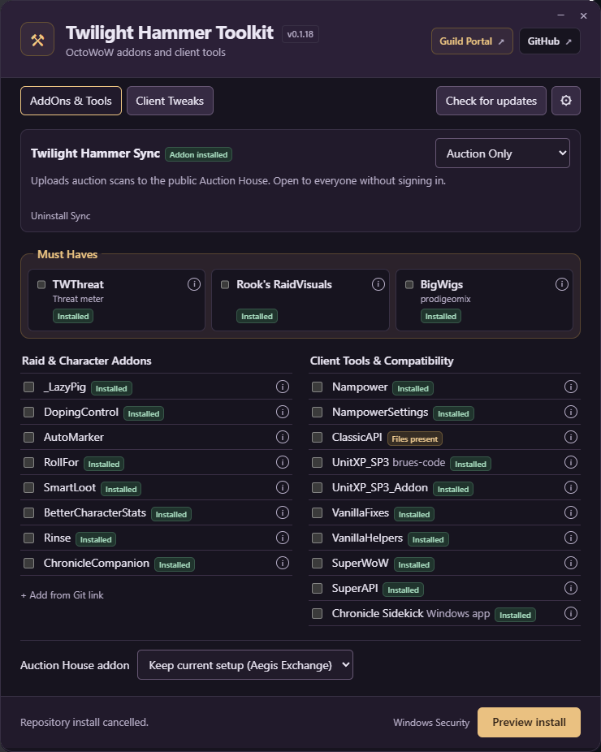

# Twilight Hammer Toolkit

A one-stop Windows installer for [OctoWoW](https://octowow.st/): Twilight Hammer Sync, popular raid addons, client mods, and optional client tweaks, all from a single app.


Current version: **v0.1.23**





- **Guild Portal:** https://twilighthammer.hccpride.workers.dev/
- **Releases:** https://github.com/obs1deus/twilighthammertoolkit/releases

- [Roadmap](ROADMAP.md)
- [Code signing policy](CODE_SIGNING.md)
- [Privacy policy](PRIVACY.md)

## Features

- **Twilight Hammer Sync** installer with three editions (Guild Sync, Auction Only, Bank and Guild Sync) and a background uploader.
- **Addon and client-mod catalog** with installed indicators for supported components, including manual installs.
- **Add from Git link** previews and installs addons from public GitHub, Gitea, and Forgejo repositories.
- **Client tweaks** for the OctoWoW Modernized client: auto-loot, memory, nameplate range, field of view, render distance, ground clutter, camera distance, and background sound.
- **Check my PC** recommends a starting render distance based on your RAM and CPU threads.
- **Automatic dependency handling.** Required components are added to the install plan for you, and detected prerequisites are reused.
- **Backups** of the executable, config, and replaced package files before anything is changed.
- **Update checks** for the Toolkit itself and for the addons and client tools it installed.
- **Windows Security help** for when an upstream file gets blocked.
- **No extras needed.** No Node.js, no PowerShell, and no administrator access when your game folder is writable.

## Requirements

- Windows
- An OctoWoW install (the folder containing `WoW.exe`)
- Close OctoWoW for client mods, data patches, client tweaks, and Sync setup. Addon-only installs and updates can run with the game open.

The Toolkit uses the Microsoft Edge WebView2 Evergreen Runtime installed on Windows. If it is missing, the Toolkit offers to download and run Microsoft's signed installer on first launch. If setup is skipped or WebView2 cannot start, the Toolkit opens a native Windows interface for the built-in catalog, Sync, and client tweaks.

## Getting started

1. Download the latest zip from [Releases](https://github.com/obs1deus/twilighthammertoolkit/releases) and extract it.
2. Run `TwilightHammerToolkit.exe`.
3. Choose your game folder. To change it later, open the settings gear.
4. Pick a Sync edition, or choose **Skip Sync** if you only want addons or client tweaks.
5. Tick any optional components you want. Everything starts unchecked.
6. Optionally turn on **Apply client tweaks** and adjust the values.
7. Review the install plan and confirm.

If you installed DLL mods, start the game with **VanillaFixes** so they load.
After addon-only installs or updates, run `/reload`. If a newly installed addon is missing from the game's addon list, restart OctoWoW.

## Twilight Hammer Sync

Sync captures game data with an in-game addon and uploads it to the Twilight Hammer guild portal.

| Edition | What it captures |
| --- | --- |
| **Guild Sync** | Professions, the Twilight Hammer roster, and auction scans |
| **Auction Only** | Completed Aegis Exchange, Aux, and OctoAuctionator scans |
| **Bank and Guild Sync** | Everything in Guild Sync, plus Twilightbank bags, bank contents, and gold |

**How the uploader works**

- It registers a Windows scheduled task that checks your OctoWoW game files for changes every two minutes while you're signed in to Windows.
- New captures are sent over HTTPS.
- Auction Only uploads anonymously. Guild Sync requires one-time approval through the portal's Discord sign-in. An officer or admin must approve Bank and Guild Sync.
- Choosing a Sync edition replaces any existing Twilight Hammer Sync setup.

**Getting captures to save**

Check that the addon is enabled at character selection. With SuperWoW installed, captures save immediately. Without it, log out or reload to write them to disk.

**Uninstalling Sync**

Click **Uninstall Sync** under Addons & Tools. This removes the uploader and its scheduled task, and you can optionally remove the WoW addon too (close OctoWoW first). Saved captures, sync logs, and portal data are kept.

## Addons & Tools

Optional components are grouped like this in the app.

### Must Haves

| Component | What it does |
| --- | --- |
| TWThreat | Threat meter showing your threat relative to the tank |
| Rook's RaidVisuals | OctoWoW client patch that changes spell visuals and sounds to make raid mechanics easier to see |
| BigWigs | Boss ability timers and raid warnings (prodigeomix fork) |

### Raid & Character Addons

| Component | What it does |
| --- | --- |
| _LazyPig | Configurable shortcuts and automation, such as dismounting and accepting invites |
| DopingControl | Checks raid consumables, buffs, debuffs, resistances, hit, and enchants before a pull |
| AutoMarker | Automatically assigns raid target icons to configured enemies |
| RollFor | Helps manage loot rolls and track who rolled on an item |
| SmartLoot | Moves and compacts loot roll frames, and can remember your Need, Greed, or Pass choices |
| BetterCharacterStats | Adds more detailed combat stats to the character panel |
| Rinse | Helps identify and dispel removable debuffs on party and raid members |
| ChronicleCompanion | Adds extended unit data to combat logs for ChronicleClassic (requires Nampower) |

### Client Tools & Compatibility

| Component | What it does |
| --- | --- |
| Nampower | Client mod that improves spell handling and adds functions for compatible addons |
| NampowerSettings | In-game settings panel for Nampower |
| ClassicAPI | Adds newer WoW API functions to the vanilla client |
| UnitXP_SP3 | Client mod (brues-code) that exposes extra unit information, including distances |
| UnitXP_SP3_Addon | Companion addon for UnitXP_SP3 |
| VanillaFixes | Launcher and fixes for the 1.12 client that can also load compatible DLL mods |
| VanillaHelpers | Helper library adding file access, minimap functions, and graphics features |
| SuperWoW | Extends vanilla APIs, including the live file export that Sync uses |
| SuperAPI | Companion compatibility addon for SuperWoW |
| Chronicle Sidekick | Windows tray app that uploads combat logs to Chronicle |

**Chronicle Sidekick** installs as its own app and can be opened from the Start menu. Sign in to Chronicle there to upload logs.

### Auction House addon

Choose one, or keep your current setup:

- **Aegis Exchange**: auction search, full scans, and pricing tools
- **Aux**: auction search, pricing, and posting tools
- **OctoAuctionator**

## Client tweaks

Tweaks apply to the verified OctoWoW Modernized client (`WoW_Modernized.exe`) and `Config.wtf`. They're opt-in: nothing changes unless you tick **Apply client tweaks**, and unchecked switches leave the client's current behavior alone.

| Tweak | Default in app | Notes |
| --- | --- | --- |
| Always auto-loot | Off | Loots automatically. Hold the bound auto-loot key (Shift by default) for manual loot |
| Large Address Aware | On | Lets the 32-bit client use more than 2 GB of memory |
| Nameplate range | 30 yd | Vanilla is 20, Classic is 41 (range 1 to 100) |
| Field of view | 110° | Vanilla is 90°. 110° suits widescreen (range 60 to 150) |
| Render distance | 2200 | Vanilla is 777 (range 777 to 3000). Very high values can crash when entering the world |
| Ground clutter distance | 300 | Vanilla is 70 (range 0 to 1000) |
| Camera distance | 75 | Vanilla is 50. Toolkit limit is 100 |
| Background sounds | On | Keeps game audio playing while the window is in the background |

**Check my PC** estimates a starting render distance from your RAM and CPU threads. **Use recommendation** fills the field so you can review it before applying.

## Backups

Before applying changes, the Toolkit saves the previous executable, config, and any replaced package files to a timestamped folder:

```
<game folder>\.twilight-toolkit\backups\yyyyMMdd-HHmmss
```

## Updates

The Toolkit checks for updates at launch and every 30 minutes while open. Use **Check for updates** under the settings gear to check manually. When a Toolkit release is available, **Update Available** opens the changelog and offers **Install Update**. The Toolkit verifies the new executable before replacing the current copy and reopening.

**Installed Addons** shows addon versions from their manifests. Choose **Pages** or **Scroll** without resizing the window. **Update All** installs available updates in the active view. Selecting a new addon keeps the main action labeled **Install**, even when the same plan includes updates. Git installs from earlier releases may need their repository links added again to enable update checks. The trash button moves addon files into the Toolkit backup folder and keeps saved game settings. Built-in recommendations stay in the catalog after removal.

Open **View log** under the settings gear for timestamps, update checks, installation events, and errors. The Toolkit keeps its current log and one previous log in its Windows app data folder.

## Windows Security

Some upstream mods (DLL injectors in particular) can trigger antivirus warnings. If Windows blocks a downloaded file, click **Windows Security** in the footer. It gives you:

- Steps for reviewing the entry in Protection History
- Copyable game-folder and Toolkit-folder paths
- A link to submit a suspected false positive to Microsoft
- **Check again**, which re-checks selected or Toolkit-managed component files

The Toolkit never changes your antivirus settings. Compare the detected file and publisher against the upstream release before allowing anything, and if a blocked download stops setup, rerun with that component unchecked.

## Downloads and security

- Catalog components come from their upstream repositories. **Add from Git link** reads the default branch of a public HTTPS repository and previews detected WoW addons before installing them.
- Downloads are size-limited and redirect-limited, and setup stops if an upstream source changes mid-install so you can retry against the current revision.
- The Toolkit installs game addons and mods into your OctoWoW folder. A writable game folder allows installation without administrator access.

## Build from source

On Windows, run `powershell.exe -NoProfile -File .\toolkit\Build.ps1` from the repository root. The build fetches the pinned WebView2 SDK from NuGet and writes `dist\Toolkit\TwilightHammerToolkit.exe`. The root `build.ps1` builds the standalone Sync editions.

## License

The Toolkit and Twilight Hammer Sync source in this repository are available under the [MIT License](LICENSE). Third-party components retain their own licenses.

## Credits

The Toolkit packages and installs work by many other authors. Each component comes from its own upstream project and keeps its own license. Thanks to the authors of BigWigs (prodigeomix), RollFor, _LazyPig, AutoMarker, SmartLoot, BetterCharacterStats, Rinse, DopingControl, ChronicleCompanion, Chronicle Sidekick, Nampower, ClassicAPI, UnitXP_SP3, VanillaFixes, VanillaHelpers, SuperWoW, SuperAPI, Aegis Exchange, Aux, OctoAuctionator, and the rest of the OctoWoW community.

The modern interface uses Microsoft Edge WebView2. The build copies the SDK license and notices into the Toolkit output folder for distribution with the EXE.
